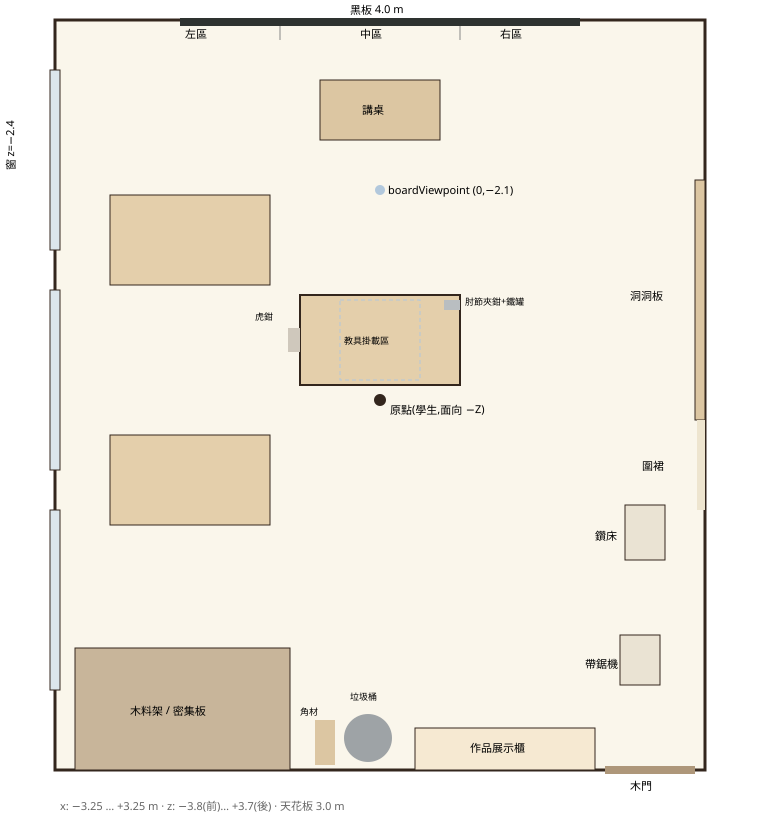

# 教室配置(俯視)

單位:公尺。原點 = 學生站立處(地面),學生面向 −Z(黑板),+X 為右手邊。所有數值的唯一來源是 `src/scene/classroom/layout.js`。



```
            z=-3.8  ┌──────────── 前牆:黑板 (0,1.65,-3.76) 4.0×1.2 ────────────┐
                    │        [左區1.0][  中區1.8  ][右區1.2]   時鐘(0,2.6)         │
       窗 z=-2.4 ▌  │                  ┌講桌 (0,0,-2.9)┐                         │
                 ▌  │  ┌桌(-1.9,-1.6)┐  ● boardViewpoint (0,0,-2.1)              │▐ 洞洞板
                    │                                                             │▐ z -2.2…0.2
       窗 z=-0.2 ▌  │              ┌──工作桌 (0,0.85,-0.6)──┐                     │▐ y 1.0…2.2
                 ▌  │        虎鉗▕ │  [掛載區 0.8×0.8]   夾鉗/鐵罐               │
                    │              └───────────────────────┘                     │▐ 圍裙 z≈0.62
                    │                       ● 原點(學生)                           │
       窗 z=+2.0 ▌  │  ┌桌(-1.9,0.8)┐                                 [鑽床 (2.65,1.3)]
                 ▌  │                                                 [帶鋸 (2.6,2.6)]
            z=+3.7  └[木料架 x-3.05…-0.9][角材][垃圾桶][展示櫃 x0.35…2.15][門 x2.7]┘
                  x=-3.25                                                   x=+3.25
```

## 物件座標與尺寸

| 物件 | 位置 | 尺寸 / 備註 |
| --- | --- | --- |
| 房間內部 | x −3.25…3.25,z −3.8…3.7 | 高 3.0;護牆板 1.0 m |
| 學生工作桌 | 桌面中心 (0, 0.85, −0.6) | 1.6 × 0.9,桌面厚 0.05,無背板 |
| 教具掛載區 | 中心 (0, 0.85, −0.6) | 0.8 × 0.8,完全淨空 |
| 圓木凳 | (0.38, 0, −0.5) 等 3 張 | 座高 0.46,座面 r 0.16 |
| 木工虎鉗 | 桌面左端面 (−0.8, 0.85, −0.6) | 鉗口朝 −X |
| 肘節夾鉗(toggleEgg) | (0.72, 0.85, −0.93) | 夾臂朝 −X |
| 空鐵罐 ×3(cans) | (0.66,−0.66)(0.585,−0.745)(0.70,−0.77),y 0.85 | r 0.033,高 0.122 |
| A3 圖紙 ×4、鉛筆、橡皮擦、30 cm 鋼尺、F 夾 ×2、C 夾 | 桌面左右條帶 x∈[±0.42, ±0.8] | 不入侵掛載區 |
| 其他工作桌 | (−1.9, 0.85, −1.6)、(−1.9, 0.85, 0.8) | 同款 |
| 黑板 | 中心 (0, 1.65, −3.76) | 4.0 × 1.2;左區 x −2.0…−1.0、中區 −1.0…0.8、右區 0.8…2.0 |
| 時鐘 | (0, 2.6, −3.77) | r 0.16,固定 8:20 |
| 講桌 | (0, 0, −2.9) | 1.2 × 0.6 × 1.0 |
| 窗 ×3 | x −3.25,z −2.4 / −0.2 / 2.0 | 1.8 × 1.6,窗台 0.9 |
| 窗外 | 走廊 1.6 m、操場低 4.0 m、背景弧板 R 70 m | 3D 近景 + 弧形背景 |
| 洞洞板 | x 3.25,z 中心 −1.0,y 1.0…2.2 | 2.4 × 1.2 |
| 圍裙掛勾 | x 3.25,z 0.62,y 1.75 | 4 件,間距 0.27 |
| 落地鑽床 | 底座 (2.65, 0, 1.3) | 高 ≈1.6,正面朝 −X |
| 帶鋸機 | 底座 (2.6, 0, 2.6) | 高 ≈1.65,工作台 0.38 見方 |
| 木料架 | x −3.05…−0.9,貼後牆 z 3.7 | 深 0.62,三層 0.12 / 0.95 / 1.65 |
| 密集板 ×14 | 底層 | 2.44 × 1.22,9–18 mm |
| 角材 ×5 | x ≈ −0.55,斜靠後牆 | 長 2.4 |
| 垃圾桶 | (−0.12, 0, 3.38) | r 0.24,高 0.72 |
| 作品展示櫃 | x 0.35…2.15,貼後牆 | 深 0.42,高 1.8,層板 0.45/0.95/1.4 |
| 木門 | 後牆 x 中心 2.7 | 0.9 × 2.1,上半小玻璃窗 |
| 天花燈 | x ±1.6 × z −2.4/0/2.4 | 0.6 × 1.2 |
| 吊扇 | (0, 3.0, −1.6)、(0, 3.0, 1.8) | |
| 站位 bench / board | (0,0,0) / (0,0,−2.1) | 皆面向 −Z |
